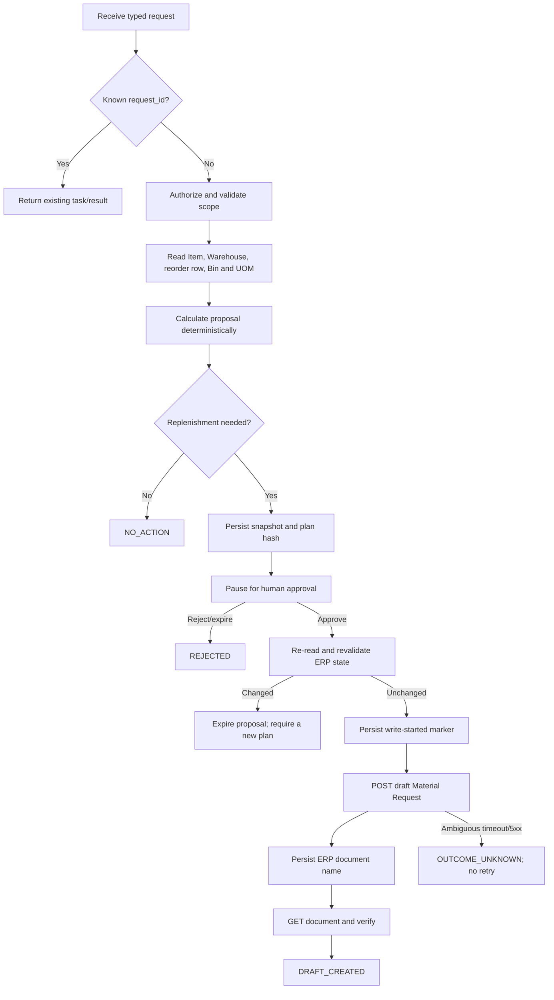

# First Milestone — Approval-Gated Replenishment Draft

**Status:** In progress; read-only ERPNext proposal path and the persistent LangGraph approval workflow API are implemented. No ERPNext mutation exists yet.
**Depends on:** [`project-brief.md`](./project-brief.md)  
**Last reviewed:** 2026-09-03

## 1. Objective

Prove one safe end-to-end integration with ERPNext:

> Given one explicit item and one non-group warehouse, read the current reorder configuration and projected stock through authenticated ERPNext APIs, calculate a replenishment proposal deterministically, pause for human approval, and create at most one **draft Purchase Material Request** through the API.

This milestone teaches the ERPNext transaction and API boundary before adding broad agent architecture. It uses a typed request; natural-language interpretation and an LLM are deliberately excluded.

## 2. Why this is not ERPNext auto-reorder

ERPNext already has an automatic reorder feature. The installed v16 source compares projected quantity with the configured reorder level and, when enabled, creates **and submits** Material Requests.

The proposed service is justified only by different controls:

- show an exact dry-run before mutation;
- require an attributable human approval;
- create a draft (`docstatus = 0`) and never submit it;
- invalidate approval when relevant ERP state changes;
- prevent the service from blindly repeating an uncertain write;
- keep workflow checkpoints and a sanitized audit trail outside ERPNext.

Before testing, confirm that ERPNext's **Raise Material Request when stock reaches re-order level** setting is disabled, or isolate the test Item so the built-in scheduler cannot create a competing Material Request.

## 3. Confirmed local context and test fixture

The active development target is the Frappe development bench, not the separate
`pwd.yml` stack that exposes port 8080:

| Property | Live-verified value |
|---|---|
| Bench path in development container | `/workspace/development/frappe-bench` |
| Site | `development.localhost` |
| Browser URL | `http://development.localhost:8000` |
| Container-local API URL | `http://127.0.0.1:8000` with `Host: development.localhost` |
| Runtime | Frappe/ERPNext development server started with `bench start` |
| API authentication | Dedicated token user `agentic-api@jg-investors.test` |

The development fixture was created and verified through authenticated read-only
API calls:

| Property | Verified value |
|---|---|
| Company | `JG Investors (Demo)` (`JGD`) |
| Warehouse | `Agentic Test Warehouse - JGD` |
| Warehouse constraints | Enabled, non-group, company `JG Investors (Demo)` |
| Item | `AGENTIC-TEST-ITEM` / `Agentic Test Item` |
| Item constraints | Enabled stock Item, no variants, stock UOM `Nos` |
| Lead time | 3 days |
| Reorder level / quantity | 10 / 20 |
| Material Request type | `Purchase` |
| Current Bin | Missing (`GET Bin` returned `{"data":[]}`) |
| Interpreted projected quantity | 0 |
| Expected first proposal quantity | 20 `Nos` |

The Item Reorder row currently has both `warehouse` and `warehouse_group` set to
the same non-group test Warehouse. The installed v16 form script rejects clearing
`warehouse_group` even though the DocType field is optional. For this fixture,
using the same non-group Warehouse does not aggregate other warehouses and is
accepted as a version-specific compatibility case. Do not patch ERPNext core to
change this behavior.

The dedicated role has read access to Company, Warehouse, Item, UOM, and Bin,
and read/create access to Material Request. It has no write, submit, cancel,
amend, or delete permission. User Permissions restrict it to the test Company
and Warehouse. Token identity, Company, Warehouse, Item/reorder configuration,
and the missing-Bin case have all been verified through the API. API credentials
must remain outside source control and documentation.

The Stock Settings **Raise Material Request when stock reaches re-order level**
(`auto_indent`) and **Notify by email on creation of automatic Material Request**
options were manually confirmed unchecked on 2026-08-29. ERPNext's built-in
automatic Material Request workflow is therefore disabled for this experiment.

## 4. Scope

### Included

- One site, one company, one item, and one target warehouse per task.
- Purchase replenishment only.
- Read-only discovery, deterministic calculation, dry-run, approval interrupt, draft creation, and read-back verification.
- A dedicated ERPNext API user, a persistent workflow checkpoint, an application audit record, and platform-level duplicate protection.
- Happy-path, denial, stale-state, permission, timeout, restart, and duplicate tests.

### Excluded

- LLMs, prompts, chat, RAG, MCP, multi-agent supervisors, event consumers, and scheduled automation.
- Group warehouses, Item templates/variants, multiple Items, transfers, issues, manufacture, subcontracting, or customer-provided material.
- Material Request submission, Purchase Orders, RFQs, supplier communication, accounting entries, deletion, cancellation, or amendment.
- Direct ERPNext database access and ERPNext/Frappe core changes.

## 5. Actors and authority

- **Requester:** authenticated platform user who asks for a replenishment assessment.
- **Approver:** authenticated human allowed to approve the exact proposal. For the first milestone, the requester and approver should be different identities unless explicitly relaxed for local testing.
- **ERPNext API user:** dedicated integration user whose token is stored outside source control.

The installed Material Request definition grants standard Purchase/Stock User and Manager roles broad create, submit, cancel, amend, and delete capabilities. For least privilege, configure a dedicated role through ERPNext's supported Role Permission Manager with only the permissions required for this milestone:

- read Item, Item Reorder data, Bin, Warehouse, Company, and UOM;
- create and read Material Request and its child Items;
- no submit, cancel, amend, or delete permission;
- User Permissions limited to the test company and warehouse where feasible.

The service must also omit all submit/cancel/delete operations from its ERPNext client. Application policy and ERPNext permission are separate defenses.

## 6. Typed request and outcomes

The request contract is intentionally explicit:

| Field | Rule |
|---|---|
| `request_id` | Caller-generated stable UUID; the same ID represents the same intent. |
| `company` | Required ERPNext Company name. |
| `item_code` | Required exact Item name/code. |
| `warehouse` | Required exact target Warehouse name. |

Requester identity comes from authentication, never from a trusted body field.

Possible terminal outcomes are `NO_ACTION`, `REJECTED`, `DRAFT_CREATED`, `DENIED`, `FAILED_SAFE`, and `OUTCOME_UNKNOWN`. `OUTCOME_UNKNOWN` requires reconciliation and must never trigger an automatic second POST.

## 7. Workflow and state transitions



The approval must contain the task ID, plan hash, approver identity, decision, timestamp, and optional reason. It expires after a configurable duration. Approval never authorizes a changed plan.

## 8. ERPNext records and API contract

Frappe supports token authentication using `Authorization: token <api_key>:<api_secret>` and applies the selected user's roles to every request. Generic DocType CRUD is available through `/api/resource/{doctype}`. API v1 is the initial candidate because it is sufficient and documented; v2 should not be mixed into the first workflow without a reason.

Candidate calls, to be confirmed against the restored site:

| Purpose | Method and path |
|---|---|
| Verify token identity | `GET /api/method/frappe.auth.get_logged_user` |
| Read Item with `reorder_levels` | `GET /api/resource/Item/{item_code}` |
| Read Warehouse | `GET /api/resource/Warehouse/{warehouse}` |
| Read UOM | `GET /api/resource/UOM/{stock_uom}` |
| Read matching Bin fields | `GET /api/resource/Bin` with encoded filters for `item_code` and `warehouse` and an explicit field allowlist |
| Create draft | `POST /api/resource/Material%20Request` |
| Verify draft | `GET /api/resource/Material%20Request/{name}` |

All path values and JSON query parameters must be encoded by the HTTP client. Responses must be validated against typed schemas; unexpected fields are ignored and missing required fields fail closed.

### Confirmed source fields

- **Item:** `item_code`, `item_name`, `description`, `item_group`, `disabled`, `is_stock_item`, `has_variants`, `variant_of`, `stock_uom`, `lead_time_days`, and child table `reorder_levels`.
- **Item Reorder row:** `warehouse_group`, `warehouse`, `warehouse_reorder_level`, `warehouse_reorder_qty`, and `material_request_type`.
- **Warehouse:** `warehouse_name`, `company`, `disabled`, `is_group`, and `parent_warehouse`.
- **Bin:** `actual_qty`, `planned_qty`, `indented_qty`, `ordered_qty`, `reserved_qty`, production reservation fields, and `projected_qty`.
- **Material Request header:** `naming_series`, `material_request_type`, `company`, `transaction_date`, `schedule_date`, and `items`.
- **Material Request Item:** `item_code`, `item_name`, `description`, `item_group`, `qty`, `uom`, `conversion_factor`, `stock_uom`, `warehouse`, and `schedule_date`.

For a stock Item, Warehouse is enforced by ERPNext even though the child field is not statically marked required. Saving the draft invokes server-side Material Request and shared buying validations.

## 9. Business rules, version 1

### Eligibility

Fail closed unless all conditions hold:

1. The Item exists, is enabled, is a stock Item, and is neither a template nor a variant.
2. The Warehouse exists, is enabled, is not a group, and belongs to the requested Company.
3. Exactly one Item Reorder row targets that Warehouse and has type `Purchase`. Its optional availability Warehouse must either be empty or equal the same non-group target Warehouse; group aggregation is excluded.
4. At least one of reorder level or reorder quantity is greater than zero.
5. The API actor has the required read/create scope.

No matching reorder row means `NO_ACTION`, not an inferred business rule.

### Quantities

Use ERPNext's stored `Bin.projected_qty`; do not reconstruct it from partial client data. Installed v16 calculates it as:

```text
actual + ordered + requested + planned
- reserved
- reserved_for_production
- reserved_for_subcontract
- reserved_for_production_plan
```

If no Bin exists, use projected quantity `0`, matching the installed reorder behavior.

```text
triggered = (projected_qty <= reorder_level)
deficiency = max(reorder_level - projected_qty, 0)
proposed_stock_qty = max(configured_reorder_qty, deficiency)
```

Use the Item's stock UOM with conversion factor `1` in this milestone. If the UOM requires whole numbers, round the proposed quantity upward. Do not add forecasting, safety stock, supplier minimum-order, pack-size, or pricing logic; those require separate business decisions.

### Dates and draft payload

- `transaction_date`: current date in the ERPNext site's configured timezone.
- `schedule_date`: transaction date plus non-negative `lead_time_days`; show it in the proposal.
- `material_request_type`: always `Purchase`.
- `status`/`docstatus`: allow ERPNext to save the document as Draft/`0`.
- `naming_series`: use the site's active default or an explicitly confirmed series; do not hard-code the image default.
- Include one child row with the confirmed Item identity, stock UOM, conversion factor `1`, proposed quantity, target Warehouse, and required-by date.

Never call a submit method or send `docstatus = 1`.

## 10. Stale-data and duplicate controls

The saved proposal snapshot must include the relevant Item/reorder row, Warehouse, Bin quantities and modification markers, calculated quantity/date, site, company, rule version, and API payload. Its canonical hash identifies the exact plan.

Immediately before the POST, re-read the ERP data and recompute the proposal. Any material difference expires the approval and returns to planning.

Duplicate protection is application-owned:

- enforce a unique `request_id` in the platform store;
- if a service-created draft already exists for the task, return its name after verification;
- persist `WRITE_STARTED` before the POST and `DRAFT_CREATED` plus the returned ERP name immediately after it;
- never retry a mutation automatically after a timeout, connection loss during send, HTTP 5xx, process crash after `WRITE_STARTED`, or an unparsable response;
- reconcile an ambiguous write manually before allowing any new POST.

Frappe's generic create endpoint does not provide a confirmed idempotency-key contract for this document. Preventing duplicates across manually created drafts is therefore unresolved. If global deduplication is required later, evaluate an approved custom reference field or a server-supported query—not direct SQL and not heuristic automatic retries.

## 11. Failure behavior

| Condition | Required behavior |
|---|---|
| Invalid platform identity or scope | `DENIED`; do not call ERPNext. |
| ERPNext 401/403 | `DENIED`; sanitize response and alert configuration owner. |
| Missing/disabled Item or Warehouse | `FAILED_SAFE`; no proposal or write. |
| Missing reorder row or no shortage | `NO_ACTION`. |
| Multiple/mismatched reorder rows | Configuration error; human correction required. |
| Approval rejected or expired | `REJECTED`; no write. |
| ERP data changed after approval | Expire proposal and require a new approval. |
| Read timeout/429/transient 5xx | Bounded retry with backoff; reads only. |
| POST validation 4xx | `FAILED_SAFE`; do not retry unchanged input. |
| POST timeout/5xx/connection ambiguity | `OUTCOME_UNKNOWN`; never auto-retry. |
| Read-back missing or mismatched draft | `OUTCOME_UNKNOWN`; human reconciliation. |

Logs must record correlation IDs, task state, decisions, ERP document names, timing, and sanitized error classes. They must not contain API secrets or unrestricted ERP payloads.

## 12. Acceptance scenarios

The milestone is complete only when automated tests and a non-production API test demonstrate:

1. A valid shortage produces the expected dry-run without writing before approval.
2. Projected quantity above the threshold returns `NO_ACTION`.
3. No Bin is treated as zero in a documented test case.
4. Ineligible Items, group/disabled/wrong-company Warehouses, non-Purchase rules, and unauthorized actors fail closed.
5. Rejection and expiry create no ERP document.
6. Changing Bin or reorder data invalidates an earlier approval.
7. Approval creates exactly one draft Material Request with the expected company, item, warehouse, quantity, UOM, dates, and `docstatus = 0`.
8. The created draft is verified through a GET request.
9. Replaying the same `request_id` returns the existing task/result and does not POST again.
10. A restart while waiting for approval resumes the same task.
11. An ambiguous write enters `OUTCOME_UNKNOWN` and is not retried automatically.
12. The integration user cannot submit, cancel, amend, or delete the Material Request.
13. Source inspection and network-level test evidence show no direct ERPNext database access.

## 13. Unresolved decisions and blockers

- Inspect the site's timezone, active Material Request naming series, and any custom workflows or required custom fields before the first write test.
- Choose the platform requester/approver identities and decide whether they may be the same person during local development.
- SQLite and a configurable 30-minute approval expiry are selected for the local single-process proof. Select the production checkpoint/audit store, retention, and encryption policy before deployment.
- Decide whether service-created draft deduplication is sufficient or a globally queryable ERPNext operation reference is required.
- Confirm the remaining API v1 UOM and Material Request read schemas before attempting the one approved draft write.

## 14. Implementation checkpoint — first LangGraph slice

The initial graph now uses the existing read-only proposal builder as its first
node, stores JSON-safe typed state under the request UUID, computes a canonical
SHA-256 plan hash, and pauses with an approval interrupt. It rejects mismatched
plan hashes, self-approval by default, expired approvals, repeated terminal
decisions, and reuse of a request ID for different intent or identity.

The local runtime can persist checkpoints in an ignored SQLite file and has an
automated close/reopen/resume test. Approval currently terminates at
`APPROVED_NO_WRITE`; there is intentionally no ERPNext mutation node. The graph
is exposed through authenticated FastAPI start/status/decision routes. The
requester and approver use distinct configured API keys; the decision request
cannot assert its own approver identity or timestamp.

An approval now routes through a second execution of the complete read-only
proposal builder. If the canonical result differs, the graph terminates at
`STALE_REPLAN_REQUIRED` and the old approval cannot continue. An unchanged plan
terminates at `APPROVED_NO_WRITE`. A temporary read failure leaves the recorded
approval at `APPROVED_PENDING_REVALIDATION`, where only the exact same approval
can retry the safe read.

On 2026-09-03, the repeatable `erpnext_agentic.check_workflow` smoke check used
the live development fixture to produce the expected 20 `Nos` proposal, paused,
reconstructed the FastAPI application, restored the SQLite checkpoint, and
resumed to `APPROVED_NO_WRITE`. The post-approval ERPNext read produced the same
plan hash. The check used temporary platform credentials and a temporary
checkpoint and performed no ERPNext mutation.

## 15. Evidence consulted

Installed source in `frappe/erpnext:v16.26.2`:

- `erpnext/stock/reorder_item.py`
- `erpnext/stock/doctype/bin/bin.py`
- `erpnext/stock/doctype/material_request/material_request.py` and its DocType JSON
- Item, Item Reorder, Warehouse, Bin, and Material Request Item DocType JSON
- `erpnext/buying/utils.py`

Official documentation:

- [Frappe REST API](https://docs.frappe.io/framework/user/en/api/rest)
- [Frappe REST API versions and routes](https://docs.frappe.io/framework/user/en/guides/integration/rest_api)
- [Frappe users and permissions](https://docs.frappe.io/framework/user/en/basics/users-and-permissions)
- [ERPNext Material Request](https://docs.frappe.io/erpnext/material-request)
- [ERPNext auto creation of Material Request](https://docs.frappe.io/erpnext/auto-creation-of-material-request)
- [ERPNext Projected Quantity](https://docs.frappe.io/erpnext/projected-quantity)
