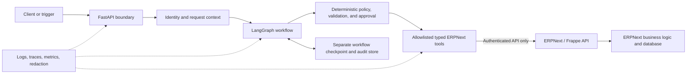

# ERPNext Agentic Platform — Project Brief

**Status:** Proposed context baseline; the platform is not yet implemented.  
**Source:** Synthesized from the ChatGPT conversation **“ERPNext Agentic Project,”** the repository's current `README.md`, and the current project constraints. The conversation is background and design input, not an authoritative specification.

## Purpose and objectives

Build a separate Python service that adds controlled, explainable workflow automation around the ERPNext instance in `D:\ERPNext\frappe_docker`.

The intended outcomes are to:

- turn a user request, scheduled trigger, or future ERP event into a typed business task;
- combine LLM-assisted interpretation and planning with deterministic business rules;
- support stateful workflows, human approval, recovery, and auditability;
- automate selected ERPNext processes incrementally, beginning with one narrow workflow;
- provide a credible production-oriented engineering project without claiming unimplemented capabilities.

The product is workflow-centered, not merely a chatbot. A conversational interface may be added later, but it is only one possible entry point.

## Non-negotiable boundaries

- This repository owns a standalone FastAPI/LangGraph service; it does not become part of ERPNext core.
- All ERPNext reads and writes go through authenticated, supported ERPNext/Frappe APIs.
- The service must not connect to, query, or mutate ERPNext's MariaDB database directly.
- The service must not patch ERPNext/Frappe core code. Future event integration must use supported APIs, webhooks, or other explicitly approved extension points.
- ERPNext remains the system of record and enforces its document lifecycle, permissions, and business invariants.
- LLM output is untrusted input. It cannot grant permission, approve a transaction, or bypass deterministic validation.
- The first implementation must run against a development/test ERPNext site, not production.

## Evolutionary architecture

Start as a modular monolith with clear internal boundaries. Logical components can be separated later only when load, ownership, or reliability evidence justifies it.

Core responsibilities are:

- **FastAPI boundary:** API contracts, authentication, authorization context, validation, rate limits, and correlation IDs.
- **LangGraph workflow:** typed state, explicit transitions, checkpoints, approval interrupts, resume, and failure paths.
- **Planning:** use an LLM only where interpretation or constrained planning adds value. Plans must be structured and validated before execution.
- **Policy and approval:** deterministic allow/deny/approval-required decisions, independent of the LLM.
- **ERPNext tool layer:** narrow, typed operations backed by documented APIs; no generic arbitrary endpoint, SQL, or code-execution tool.
- **Platform persistence:** workflow checkpoints and audit metadata in storage owned by this service, never in the ERPNext database.

The long-term conversation proposed master/domain/process graphs across procurement, inventory, sales, finance, HR, and manufacturing. Treat that as a possible scaling pattern, not an initial requirement. Add a domain subgraph only after a real workflow needs it.

## Canonical workflow

1. Accept a request and bind it to an authenticated actor, company, and allowed scope.
2. Normalize it into a typed task containing the objective, entities, constraints, risk, and requested action.
3. Read required ERPNext state through least-privilege APIs.
4. Produce a constrained plan; use deterministic calculations for quantities, money, permissions, thresholds, and document rules.
5. Validate and dry-run the exact proposed mutation, including its expected impact.
6. Reject it, execute a read-only path, or pause for approval according to deterministic policy.
7. Bind approval to the exact plan and inputs, then re-read and revalidate relevant ERP state before execution.
8. Execute only allowlisted ERPNext API operations with an idempotency key.
9. Verify the post-condition through the API and return the ERPNext document reference.
10. Persist the outcome, decisions, approval, trace metadata, and sanitized errors.

On failure, classify the error before acting. Retry only transient reads or demonstrably idempotent operations; otherwise stop for recovery or human review. Never blindly repeat an uncertain ERP mutation.

## Safety and reliability requirements

- Use dedicated least-privilege ERPNext credentials stored outside source control and redact secrets from logs and model context.
- Preserve the initiating user's identity and authorization context; decide whether ERPNext service-account actions also require application-level delegation before production use.
- Separate read tools from mutation tools, default to read-only, and explicitly allowlist every write operation and field.
- Validate tool arguments and responses with typed schemas and ERP-aware constraints.
- Treat ERP text, attachments, retrieved documents, and external content as untrusted data to reduce prompt-injection risk.
- Require human approval for consequential actions. Approval must expire and become invalid if material inputs change.
- Make retries safe with stable operation keys, duplicate detection, timeouts, bounded backoff, post-condition checks, and explicit compensation or repair paths where feasible.
- Record who requested, planned, approved, executed, and verified an action, while minimizing or redacting sensitive data.
- Provide traceable reasons for denial, approval requests, execution, and failure; do not rely on hidden chain-of-thought.
- Test permissions, duplicate delivery, stale approvals, timeouts, restarts, malformed model output, prompt injection, and partial failures.

## Technology direction

Use Python, FastAPI, LangGraph, typed validation, an authenticated ERPNext/Frappe API client, Docker, and automated tests as the initial core. A persistent LangGraph checkpointer is required once approval can pause a workflow; SQLite is sufficient for a local proof, while PostgreSQL is the likely choice before multi-worker deployment.

Redis/queues, an event bus, RAG/vector storage, MCP, model routing, LangSmith/OpenTelemetry, multiple channels, separate microservices, and a dedicated policy engine are optional future capabilities. Introduce them only for a measured requirement. The LLM provider, model policy, deployment target, and observability backend remain undecided.

## Assumptions and complexity to challenge

- **Assumption:** a disposable development/test ERPNext site and a least-privilege API user can be created. If not, the first milestone must remain read-only.
- **Assumption:** one ERPNext site, company, and workflow are enough initially; multi-tenancy is not an MVP requirement.
- “Handle any question” is not a testable scope. Begin with explicit supported intents and fail closed on everything else.
- A master orchestrator, many specialist agents, nested domain graphs, an agent registry, a model router, event buses, distributed sagas, RAG, MCP, and multi-channel delivery together would create excessive accidental complexity now.
- Multi-agent coordination is not inherently better than one explicit workflow. Prefer deterministic nodes and a single constrained LLM step until specialization is proven useful.
- “Production-oriented” is a design direction, not the current maturity level or a CV claim.
- The conversation occasionally included SQL in a generic tool layer; this project explicitly rejects direct ERPNext database access.

## Smallest useful first milestone

Deliver one approval-gated **inventory replenishment proposal → draft Material Request** workflow against a non-production ERPNext site:

1. A FastAPI request identifies an item and warehouse, with optional natural-language intent normalized to a typed task.
2. The workflow reads item, stock, and reorder data through authenticated ERPNext APIs.
3. Deterministic code calculates the shortage and produces a dry-run proposal.
4. A human approves or rejects the exact proposal through a resumable LangGraph interrupt.
5. On approval, the service creates at most one **draft** Material Request through the ERPNext API, re-reads it for verification, and records an audit result.

Do not submit the Material Request, create a Purchase Order, contact a supplier, post accounting entries, consume ERP events, or add a chatbot in this milestone. If no safe test site is available, stop after the read-only proposal.

The milestone is complete when unauthorized or stale requests fail closed, no mutation occurs without approval, retries/resumes cannot create duplicate drafts, a restart can resume the approval flow, every ERP access is demonstrably API-based, and integration tests prove the happy path plus denial and failure cases.

## Unresolved decisions

- Exact ERPNext version, site URL/container networking, TLS expectations, and supported API endpoints.
- Authentication model: dedicated API-token user, OAuth, or delegated per-user access; required roles and permission mapping.
- Approval identity, interface, expiry, escalation, and whether ERPNext Workflow participates.
- First-milestone fields and business rules for Material Request creation, including company and warehouse scope.
- LLM provider, data-residency/privacy constraints, model allowlist, token/cost limits, and whether the first typed request needs an LLM at all.
- Checkpoint/audit database, retention, backup, encryption, and sensitive-data policy.
- Event mechanism for later milestones: ERPNext webhook, scheduler/polling, or queue-based integration.
- Deployment topology, secrets management, CI/CD, observability stack, and recovery objectives.
- Evaluation dataset and acceptance thresholds for plan validity, policy compliance, transaction accuracy, latency, and cost.
